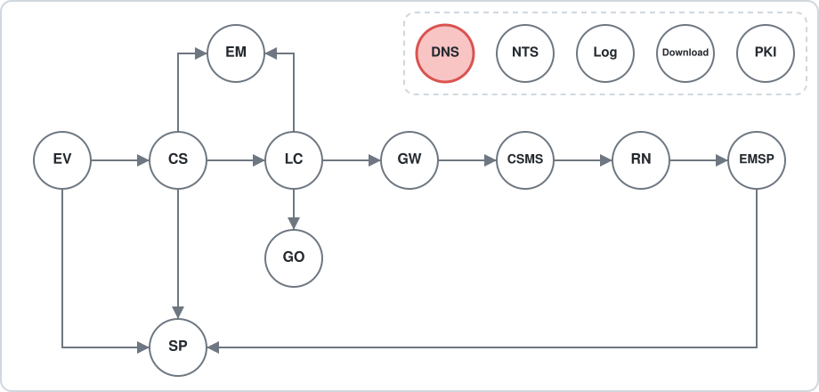

# DNSServerCLI



[](https://github.com/OpenChargingCloud/DNSServerCLI/actions/workflows/ci.yml)
[](https://github.com/OpenChargingCloud/DNSServerCLI/actions/workflows/nightly.yml)

One name server for a local network: authoritative DNS over UDP, TCP and SSH,
with a web interface, a JSON API and a prompt - at the console and over SSH -
until 'quit' or Ctrl+C.

It answers with the records it is given: in its web interface, at its prompt
(`aRecords add www.lan 192.168.1.10`, `mxRecords add lan 10 mail.lan`,
`ptrRecords add 192.168.1.10 www.lan`),
over SSH, or in the `dnsServer` section of its configuration file - and for
the zones it is given (`zones add lan`) authoritatively, with the SOA and NS
records it makes for them. Whatever is added or removed is in effect at once
and written back to that file, so that the next start answers the same.

It is a sibling of [NTSServerCLI](https://github.com/OpenChargingCloud/NTSServerCLI),
[PKICLI](https://github.com/OpenChargingCloud/PKICLI) and the others, and is
built the same way. The DNS server itself - the wire format, the listeners,
the authoritative lookups - is [Hermod](https://github.com/Vanaheimr/Hermod)'s;
what every program of the family has - the sign-in, the name servers it asks
itself, the groups of time servers and the certificates they are held to, the
SSH server with its command line, and the log - is
[WWCP_Node](https://github.com/OpenChargingCloud/WWCP_Node); what is the DNS
server's own is in [DNSServer](https://github.com/OpenChargingCloud/DNSServer).


### Getting it

The libraries it is built from are submodules, so they have to come along:

```
git clone --recurse-submodules https://github.com/OpenChargingCloud/DNSServerCLI.git
```

If you already cloned it without them:

```
git submodule update --init --recursive
```

**On Windows**, turn long paths on first: `git config --global core.longpaths true`.


### Building and running it

.NET 11 and Node 22 or newer. The build runs `npm ci` and `npm run build` for
the web interface itself whenever its inputs changed, and embeds it into the
assembly; `-p:SkipFrontendBuild=true` builds the rest alone.

```
dotnet build DNSServerCLI.slnx
dotnet run --project DNSServerCLI
```

or `./run.sh`, which takes the same switches. `--help` lists all of them.
Without a configuration file it answers DNS on port 53, UDP and TCP, on every
address of both families, with no record at all - and serves its web
interface, its JSON API, its command line over SSH and DNS over SSH on
127.0.0.1 only: http://127.0.0.1:2362/ and port 22362 (`--any` for every
address). At the first start it makes one account, `root`, and shows its
password once, on the console.

Two things may stand in the way of port 53:

* **On Linux**, a port below 1024 takes `CAP_NET_BIND_SERVICE`:
  `sudo setcap cap_net_bind_service=+ep $(readlink -f $(which dotnet))`, or a
  systemd unit with `AmbientCapabilities=CAP_NET_BIND_SERVICE` - and
  systemd-resolved may hold 127.0.0.53:53 already.
* **On Windows**, the DNS Server role or Internet Connection Sharing hold 53.

A start that cannot have its port ends there and says which switch to give
instead. Every switch of the name server says for one start what the
`dnsServer` section says for every start:

| switch | |
|---|---|
| `--dns-port <n>` | the UDP and TCP port of DNS (53) |
| `--listen <address>` | where DNS listens (`any`, every address of both families) |
| `--no-udp` | no DNS over UDP |
| `--no-tcp` | no DNS over TCP |

For a first try without privileges:

```
dotnet run --project DNSServerCLI -- --dns-port 5353 --listen 127.0.0.1
```

and, at its prompt, `aRecords add www.example.org 192.0.2.10` - or on the
Records page of http://127.0.0.1:2362/; then, from another terminal,
`dig @127.0.0.1 -p 5353 www.example.org`.


### The configuration

`configuration.json` below the repository root, or what `--config` names. The
section of the name server, with every key and its default:

```json
{
  "dnsServer": {
    "listen":      "any",
    "port":        53,
    "udp":         true,
    "tcp":         true,
    "defaultTTL":  3600,
    "records":     [
                     "www.example.org.         600     IN   A          192.0.2.10",
                     "www.example.org.         600     IN   AAAA       2001:db8::10",
                     "example.org.             3600    IN   TXT        \"v=spf1 -all\"",
                     "docs.example.org.        3600    IN   CNAME      www.example.org.",
                     "example.org.             3600    IN   MX         10 mail.example.org.",
                     "_ocpp._tcp.example.org.  3600    IN   SRV        0 5 443 csms.example.org.",
                     "10.2.0.192.in-addr.arpa. 3600    IN   PTR        www.example.org."
                   ],
    "zones":       [ {
                     "name":         "example.org.",
                     "nameServers":  [ "ns.example.org." ],
                     "hostmaster":   "hostmaster@example.org",
                     "serial":       2026112500,
                     "refresh":      86400,
                     "retry":        7200,
                     "expire":       1209600,
                     "minimum":      3600,
                     "transfer":     [ "192.0.2.53", "2001:db8:53::/48" ],
                     "transferKeys": [ "ns2-transfer." ],
                     "notify":       [ "192.0.2.53" ]
                   } ],
    "ssh":         {
                     "enabled":  true,
                     "clients":  [ { "name": "cs001", "keys": [ "ssh-ed25519 AAAA... cs001" ], "enabled": true } ]
                   },
    "tsigKeys":    [ { "name": "ns2-transfer.", "algorithm": "hmac-sha256", "secret": "base64..." } ]
  }
}
```

The records are zone-file lines (RFC 1035 § 5.1), each with its name complete,
as the prompt writes them. That is the one form every type of record has: a
record the prompt cannot make yet - a CAA, a NAPTR, an SSHFP - can be written into
the file by hand, and is answered from the next start on. A line that cannot
be read stops the start with what is wrong in it.

The zones are those the name server is authoritative for: a name and every
name below it. Their SOA and NS records are made by the server and are not
among the records. Only `"name"` is needed: the name servers are `ns.` and the
zone, the hostmaster `hostmaster@` and the zone (RFC 2142 § 7), the timers
those of RFC 1912 § 2.2, with an hour as the negative TTL (RFC 2308 § 5). The
serial is YYYYMMDDnn and is counted on by every change of a record in the
zone. The hostmaster and the timers are changed here, by hand. An SOA, NS or
CNAME record at the name of a zone stops the start.

A zone has secondaries: other name servers that hold a copy of it. They ask
for the whole of it - AXFR (RFC 5936), or IXFR (RFC 1995), which this server
answers with the SOA alone where the secondary is up to date and with the
whole zone otherwise - over TCP. `"transfer"` are their addresses and prefixes,
`"transferKeys"` the TSIG keys (RFC 8945) a request may be signed with instead,
from whatever address; a zone without either is transferred to nobody, and a
request from anybody else is REFUSED. A transfer carries the zone's SOA, its
records, the NS records and the glue of a zone within it, and its SOA again,
in one message - signed back where it was asked for with a key. `"notify"`
are the secondaries told of each new serial (NOTIFY, RFC 1996) - and of every
serial at the start - so that they ask now rather than at their next refresh;
an address, with a port where not 53. `"tsigKeys"` are written by hand, with
`tsig-keygen ns2-transfer` making one: their secrets are in this file and never
in an answer of the JSON API, and they are known from the next start on.

`"ssh"` is DNS over SSH: the subsystem `dns@open.charging.cloud` of the node's
SSH server, which carries DNS as over TCP - a two-octet length before every
message - and is answered with the same records and zones. A charging station
that runs OCPP over SSH resolves its names over the connection it has anyway,
against the host key it pins for OCPP. It is on unless `"enabled"` says
otherwise, and is asked by the DNS clients listed here - each under its name,
with one of its keys as an `authorized_keys` line (`from="..."` and
`expiry-time="..."` hold, and with `cert-authority` it is the key of an SSH CA
whose user certificates let the client in) - and by every account allowed to
run `dnsquery`. A DNS client gets nothing but the subsystem: no command line,
no SFTP. OpenSSH asks with `ssh -s -p 22362 cs001@127.0.0.1 dns@open.charging.cloud`;
the SSH server listens where the web interface does, so `--any` offers it in
the network.


### The prompt

Beside every node's commands - `queryDNS` among them, which asks the name
servers this node uses itself - the DNS server has:

* `dnsServer` - where it listens - UDP, TCP and SSH - how many records of
  which type it answers with, the zones it is authoritative for, how many DNS
  clients may ask over SSH, and how much it answered;
* `records [<name>]` - every record, or those of one name, as zone-file lines;
* `aRecords`, `aaaaRecords`, `txtRecords`, `cnameRecords`, `mxRecords`,
  `srvRecords`, `ptrRecords` - the records of one type, each the same way:

  | | |
  |---|---|
  | `aRecords [<name>]` | the A records, or those of one name |
  | `aRecords add <name> <IPv4> [<ttl>]` | the name answers with the address as well |
  | `aRecords remove <name> [<IPv4>]` | the name no longer answers with the address, or with any where none is given (`delete` works as well) |
  | `aaaaRecords add <name> <IPv6> [<ttl>]` | the same for an IPv6 address; `2001:db8::10` and `2001:0db8:0:0:0:0:0:10` are one address |
  | `txtRecords add <name> "<text>" [<ttl>]` | the name answers with the text as well: SPF, DMARC, the proof of who holds a domain. A text with spaces is put in double quotes, and within them `\"` is a double quote and `\\` a backslash, as in a zone file (`txtRecords add example.org "say \"hello\""`); one longer than 255 octets is answered in pieces, which a reader puts together again (RFC 7208 § 3.3) |
  | `cnameRecords add <name> <target> [<ttl>]` | the name is an alias of the target |
  | `mxRecords add <name> <preference> <exchange> [<ttl>]` | the mail of the name is taken by the exchange as well, the lowest preference first (RFC 5321 § 5.1); the exchange is a name with an A or AAAA record, not an address. `mxRecords remove <name> [<exchange>]` |
  | `srvRecords add <name> <priority> <weight> <port> <target> [<ttl>]` | the service - `_ocpp._tcp.example.org` - is at the target and port as well, the lowest priority first and among those of one priority by weight (RFC 2782). `srvRecords remove <name> [<target>]` |
  | `ptrRecords add <address\|name> <target> [<ttl>]` | the address points to the name: `ptrRecords add 192.0.2.10 www.example.org` makes `10.2.0.192.in-addr.arpa.`, and an IPv6 address its nibbles below `ip6.arpa.`; a name of its own - DNS-SD's `_http._tcp.example.org` - is taken as it is. `ptrRecords remove <address\|name> [<target>]` |

  The TTL is a number of seconds, or one with `s`, `m`, `h` or `d` after it
  (`10m`, `1h`); without one, `defaultTTL`. The records of one name and type
  share their TTL (RFC 2181 § 5.2), so a TTL given now is the others' of the
  name and type as well, and the answer says so.
* `zones` - the zones the name server is authoritative for, with the SOA and
  NS records it makes for them:

  | | |
  |---|---|
  | `zones [<zone>]` | every zone, or one, with its serial, hostmaster, SOA and NS records |
  | `zones add <zone> [<nameServer> ...]` | the name server is authoritative for the zone from now on; without name servers, `ns.` and the zone. A name server in the zone without an A or AAAA record is said, since a resolver cannot find it |
  | `zones remove <zone>` | it no longer is; its SOA and NS records go, its records stay (`delete` works as well) |
  | `zones transfer <zone> <address\|prefix> ... \| none` | the zone may be transferred to these secondaries from now on, and to nobody else - but by a key |
  | `zones transferKeys <zone> <key> ... \| none` | to a request signed with one of these TSIG keys of `"tsigKeys"` as well |
  | `zones notify <zone> <address[:port]> ... \| none` | these secondaries are told of each new serial |

  `zones` lists with every zone whom it is transferred to, its last transfer -
  or the last refused, and why - and whether each secondary answered its last
  NOTIFY.

  A question for a name in a zone is answered from the zone: a name that is
  not there is NXDOMAIN, and a name without the type asked NODATA, both with
  the zone's SOA, so that a resolver may keep the "no" (RFC 2308). A name above
  a zone is REFUSED - not NXDOMAIN, which would deny the zone with it (RFC
  8020). The records in no zone are answered by their name, as before. Zones
  may be within each other: a name is in the one with the longest name.
* `dnsClients` - the machines that may ask over SSH:

  | | |
  |---|---|
  | `dnsClients` | every DNS client, with its keys and what it asked last - and the accounts that asked |
  | `dnsClients add <name> <authorized_keys line>` | let a client in with a key: a new client, or one more key of one |
  | `dnsClients remove <name> [<fingerprint>]` | take a client out, or one of its keys (`delete` works as well) |
  | `dnsClients enable\|disable <name>` | switch a client on or off |
  | `dnsClients ssh on\|off` | answer DNS over SSH, or not |

  A client taken out, switched off or left without the key it came with has
  its session ended at once.

A name is complete, with or without its trailing dot, and compared without
regard to case. A name with a CNAME has no other record, and one CNAME only
(RFC 1034 § 3.6.2): a CNAME is refused where the name has records - the name
of a zone among them, with its SOA and NS records - and a record where the
name has a CNAME. Every change is logged with whoever made it.

The prompt is the console's, and every account's over SSH:
`ssh -p 22362 root@127.0.0.1`. The commands are the DNS server's and not this
program's: they live in `libs/DNSServer/DNSServer/CommandLine/`, the node hands
them to whoever signs in over SSH by itself, and `libs/DNSServer` tests them -
so that a DNS server run by another program can be told the same.


### The web interface

http://127.0.0.1:2362/, signed in with an account of the node. Beside what
every node shows - its configuration, the name and time servers it asks
itself, the SSH server, the certificate store and the log - the DNS server
has four pages of its own:

* **Name server** - whether it answers, where (UDP, TCP and SSH), the `dig`
  line to ask it with, its records by type, its zones, the default TTL, and
  how much it answered;
* **Records** - every record, of every type, as the name server answers with
  it; an A, AAAA, TXT, CNAME, MX, SRV or PTR record added with a form - its
  type, its name (for a PTR record an address as well), what it answers with,
  the preference of an MX record and the priority, weight and port of an SRV
  record, and a TTL where not the default - and removed with a button beside
  it. Every change is in effect at once and written to the
  configuration file;
* **Zones** - every zone the name server is authoritative for, with its serial,
  hostmaster, name servers and the SOA and NS records it makes, and a name
  server in it that has no address yet, whom it is transferred to and tells
  of a new serial, its last transfer and whether its secondaries answered its
  last NOTIFY; a zone added with a form - its name, and its name servers where
  not `ns.` and the zone - and removed with a button; and its secondaries set
  with a form of their own;
* **DNS clients** - whether DNS is answered over SSH, where and under which
  host key; every DNS client with the fingerprints of its keys and what it
  asked last, from where and how often, and the accounts that asked; a client
  added with its first key, another key added, a client switched off or
  removed, and DNS over SSH switched off and on.

Whoever may only look sees the same and changes nothing. The frontend is
TypeScript and SCSS, drawn with lit-html and bundled by webpack, in
`libs/DNSServer/DNSServer/Frontend`; what every kind of node shares comes from
`libs/WWCP_Node/Frontend`.


### The JSON API

Below http://127.0.0.1:2362/api/, beside every node's routes, for an account
signed in at `/ext/login` - the web interface is drawn from nothing else:

| | |
|---|---|
| `GET  v1/dnsServer` | how the name server stands: where it listens, its records by type, its zones, DNS over SSH, how much it answered |
| `GET  v1/dnsServer/settings` | the `dnsServer` section as it is in effect |
| `GET  v1/dnsServer/records` | every record: name, type, class, TTL, data as a zone file writes it, the value it is removed by, and its zone-file line |
| `ADD    v1/dnsServer/records/{type}` | `{ "name", "address" \| "text" \| "target" \| "exchange", its numbers, "ttl"? }` - one record more |
| `REMOVE v1/dnsServer/records/{type}` | `{ "name", "address" \| "text" \| "target" \| "exchange"? }` - one record, or every one of the name and type, taken away |
| `GET    v1/dnsServer/zones` | every zone: name, name servers, hostmaster, serial, timers, the SOA and NS records it makes, and a `"note"` on what it lacks |
| `ADD    v1/dnsServer/zones` | `{ "name", "nameServers"? }` - one zone more |
| `REMOVE v1/dnsServer/zones` | `{ "name" }` - one zone less; its records stay |
| `PUT    v1/dnsServer/zones/transfer` | `{ "name", "transfer"?, "transferKeys"?, "notify"? }` - the secondaries of a zone: each list given is the whole of it, each left out stays |
| `GET    v1/dnsServer/ssh` | DNS over SSH: whether it is on and answered, where, the host key, every DNS client with its keys and what it asked, and the accounts that asked |
| `PUT    v1/dnsServer/ssh` | `{ "enabled"?, "clients"?: [ { "name", "keys", "enabled" } ] }` - DNS over SSH, and who may ask there, as a whole list |

`{type}` is `a`, `aaaa`, `txt`, `cname`, `mx`, `srv` or `ptr`. A record is
added with the method `ADD` and taken away with `REMOVE`, at the same path -
not with a POST, which changes nothing there. A and AAAA records carry an
`"address"`, TXT records a `"text"` - taken as it is, quotes and spaces
included - a CNAME the `"target"` it is an alias of, an MX record its
`"preference"` and `"exchange"`, an SRV record its `"priority"`, `"weight"`,
`"port"` and `"target"`, and a PTR record the `"target"` it points to, its
`"name"` an address as well. An MX record is removed by its `"exchange"`, an
SRV or PTR record by its `"target"`:

```
curl -X ADD    -b cookies -H "Content-Type: application/json" -d '{ "name": "www.lan", "address": "192.168.1.10" }' http://127.0.0.1:2362/api/v1/dnsServer/records/a
curl -X REMOVE -b cookies -H "Content-Type: application/json" -d '{ "name": "www.lan" }'                            http://127.0.0.1:2362/api/v1/dnsServer/records/a
curl -X ADD    -b cookies -H "Content-Type: application/json" -d '{ "name": "_ocpp._tcp.lan", "priority": 0, "weight": 5, "port": 443, "target": "csms.lan" }' http://127.0.0.1:2362/api/v1/dnsServer/records/srv
curl -X ADD    -b cookies -H "Content-Type: application/json" -d '{ "name": "lan", "nameServers": [ "ns.lan" ] }'   http://127.0.0.1:2362/api/v1/dnsServer/zones
curl -X PUT    -b cookies -H "Content-Type: application/json" -d '{ "clients": [ { "name": "cs001", "keys": [ "ssh-ed25519 AAAA... cs001" ] } ] }' http://127.0.0.1:2362/api/v1/dnsServer/ssh
```

A change of the records or zones answers with what it said and the records -
or the zones - as they are now; what cannot be added is a 400, nothing to take
away a 404. A PUT of DNS over SSH answers as its GET; what it leaves out stays
as it is, and the clients it sends are the whole list.


### Who may do what

Two resources beside the node's: `nameserver` - read, how the name server
stands, its records, zones and DNS clients; edited, the same - and
`dnsquery`, run: asking over SSH. Three roles beside the node's viewer and
administrators: `operator`, who reads everything and asks the name and time
servers, `hostmaster`, who reads everything and changes the records, zones and
DNS clients, and `dnsclient`, an account that asks over SSH and nothing else.


### Where things are

| | |
|---|---|
| `DNSServerCLI/` | the command line: the name server's own switches, and its lines of what the console says at a start |
| `libs/DNSServer/` | the DNS server itself - its settings, its records and zones, Hermod's server around them, DNS over SSH and its clients, its JSON API, what can be typed at it (`dnsServer`, `records`, `aRecords`, `aaaaRecords`, `txtRecords`, `cnameRecords`, `mxRecords`, `srvRecords`, `ptrRecords`, `zones`, `dnsClients`) - and its tests |
| `libs/DNSServer/DNSServer/Frontend/` | the web interface: TypeScript and SCSS, bundled by webpack |
| `libs/WWCP_Node/` | what every one of these programs shares: the configuration file, the log, name resolution and the time, the certificate store, who may sign in, the command line over SSH, and the switches, the usage and the banner every node has |
| `libs/WWCP_Core/` | of WWCP Core only WWCP_CoreData, which WWCP_Node builds on |
| `libs/Hermod/` | the network below all of them: HTTP, TLS, SSH and DNS |
| `libs/Norn/` | NTS and NTP, with which the node checks its clock |
| `libs/Styx/`, `libs/Urdr/` | the basics below that, and time stamps (RFC 3161) |
| `.github/workflows/` | what runs on every push, and what runs at night |
| `.github/scripts/` | the start both of them make: the server asked for its web interface, its JSON API, SSH, and DNS over UDP, TCP and SSH |


### Its tests

```
dotnet test libs/DNSServer/DNSServerTests/DNSServerTests.csproj
```

A DNS server started on the loopback address, told at its console and over
its JSON API what to answer, and asked over UDP and TCP as any resolver would:
an A record added is answered at once and written to the file, twice the same
is refused, the RRset shares its TTL, one address and then the whole name
removed, the records answered again after a restart, what is no address, TTL
or name refused, a record in the file that cannot be read is no start, an
operator may look but not change, a hostmaster may change; MX, SRV and PTR
records - a PTR record for an IPv4 and an IPv6 address - answered as added,
kept over a restart and removed by the name they point to; a zone with the
SOA and NS records it makes, its negative answers authoritative and with its
SOA, a name above it refused, its serial counted on by a change and kept over
a restart, zones within each other, and what cannot be a zone refused; a zone
transferred - AXFR and IXFR, over TCP, truncated over UDP - by address and by
TSIG key with its answer signed back, refused to anybody else, its secondaries
told of each new serial and a NOTIFY not answered sent again; asked
over SSH by a DNS client with its own key and by an account with `dnsquery`,
a stranger, a client switched off and an operator turned away, a client taken
out ended at once - and WWCP_Node's conformance suite asked of a DNS server,
its web interface among it. Nothing
in them leaves the machine. The web interface's own tests - its pages drawn
against a stand-in server, and the rules every page of every kind of node is
held to - are run by node, in `libs/DNSServer/DNSServer/Frontend`:

```
npm run typecheck
npm run typecheck:test
npm test
```

**CI** runs them on every push, beside the node's own tests, on Windows and on
Debian 13; on Debian it then starts the server with records, a zone and a DNS
client in its file and asks it: `/` must be the embedded web interface, the
JSON API must be shut to anybody not signed in, SSH must answer, `dig` must
get the records over UDP and TCP, the SOA and NS records of the zone, and an
authoritative NXDOMAIN with the zone's SOA for a name without one, the zone
as a secondary transfers it - its SOA first and last - and
OpenSSH's `ssh -s` the A record over the subsystem `dns@open.charging.cloud`,
as a DNS client with a key of its own. **Nightly** runs every test of every
library at the commits pinned here - but for those that ask real name
and time servers on the Internet - starts the server the same way, says which
packages have known vulnerabilities, and builds and tests once more with every
library at its newest commit, to say what advancing them would cost.


## Your participation

This software is Open Source under the **Affero GPL 3.0 license**.
We appreciate your participation in this ongoing project, and your help to
improve it and the e-mobility ICT in general. If you find bugs, want to
request a feature or send us a pull request, feel free to use the normal
GitHub features to do so. For this please read the Contributor License
Agreement carefully and send us a signed copy or use a similar free and
open license.
